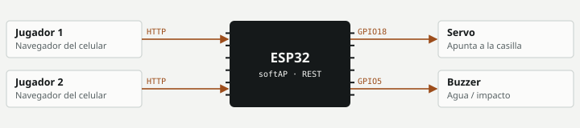

# Batalla Naval IoT

Un juego por turnos para dos jugadores alojado en un ESP32 que crea su propia red Wi-Fi; los jugadores usan el navegador del celular y un servo y un buzzer dan el efecto físico.

**Estado:** Funcional · **Periodo:** jul 2026 · **Autor:** Daniel Ignacio Pedraza Martínez

## Objetivo

Un juego que demuestre comunicación cliente-servidor en un dispositivo embebido.

## Arquitectura

El ESP32 actúa como punto de acceso y servidor. Guarda los tableros 5×5 de cada jugador, las matrices de disparos, la fase y el turno, y los expone en JSON.



## Hardware

| Componente | Función | Conexión |
|---|---|---|
| ESP32 DevKit | Punto de acceso y servidor | — |
| Servo | Indicador físico | `GPIO18` |
| Buzzer | Sonido | `GPIO5` |
| HC-SR04 (versión radar) | Medición de distancia | `TRIG 2 · ECHO 4` |

## Firmware y protocolos

- **API.** /estado, /colocar, /listo, /disparar
- **Estado.** Fases: colocación J1 → colocación J2 → juego → fin; turno y ganador
- **Versión radar.** Columna 1–5 = ángulo 45°–135°; fila A–E = franjas de 6 cm entre 6 y 35 cm

## Funcionamiento

- Cada jugador coloca 5 barcos de una casilla desde su celular.
- Los clientes consultan /estado y reciben los tableros en JSON.
- En la versión radar, el impacto se decide con la distancia real medida por el sonar.

## Decisiones técnicas

- **Access Point propio.** Funciona en cualquier lugar, sin depender de una red existente.
- **Resultado decidido por software (V2).** El sonar quedó como efecto; el código lo indica explícitamente.

## Estructura del repositorio

```
firmware/
  Batalla_Naval_Ultra/       versión radar: servo + sonar deciden el impacto
  BatallaNaval_2Jugadores/   juego por turnos con estado en el ESP32
docs/diagrama.svg
```

## Cómo compilar

1. Arduino IDE 2 con el paquete **esp32 de Espressif** (placa *ESP32 Dev Module*).
2. Instala las librerías listadas abajo desde el gestor de librerías.
3. Abre el `.ino` de la versión que quieras y súbelo.
5. Conéctate a la red Wi-Fi que crea el ESP32 (nombre y clave al inicio del sketch) y abre en el navegador la IP que muestra el monitor serie.

**Librerías:** ESP32Servo

## Evolución

- **Ultra (radar):** Servo y sonar reales deciden el impacto.
- **2 Jugadores · jul 2026:** Juego por turnos con estado en el ESP32.

## Limitaciones

- Sin autenticación de jugadores.
- Consulta periódica en lugar de WebSockets.

## Mejoras futuras

- WebSockets para actualizaciones inmediatas.
- Tableros más grandes y barcos de varias casillas.

---
Parte del [portafolio técnico](https://github.com/nshtpdrz) de Daniel Ignacio Pedraza Martínez · Ingeniería en Tecnologías de la Información y Comunicaciones, Tecnológico Nacional de México, Campus Pachuca.
